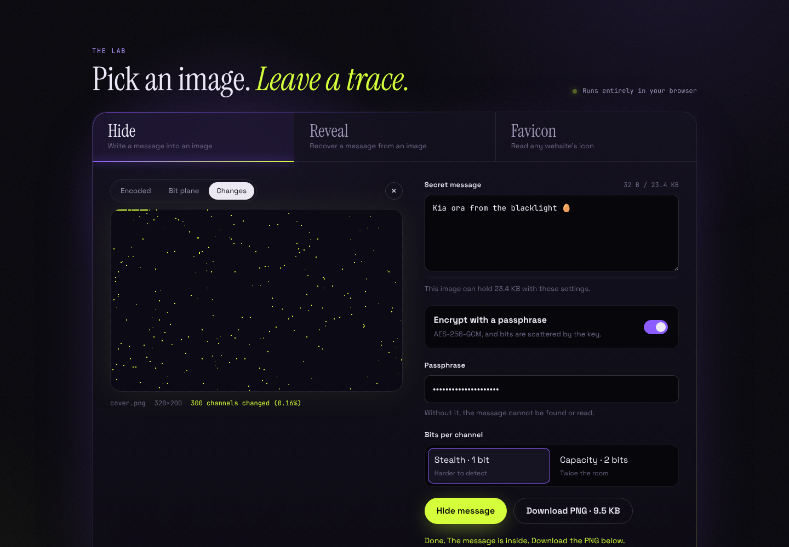
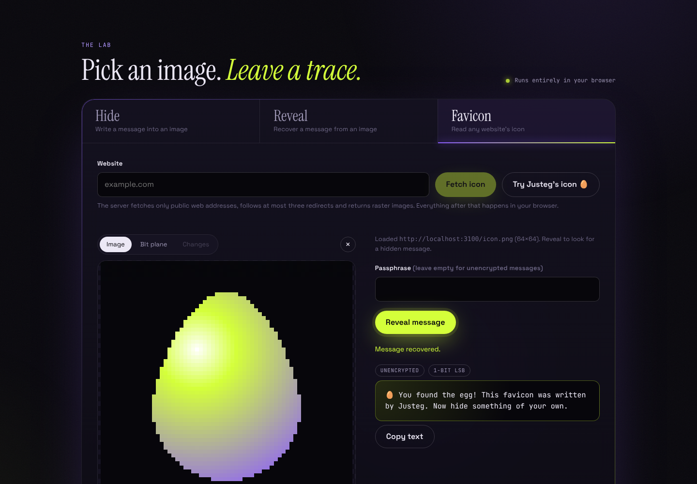
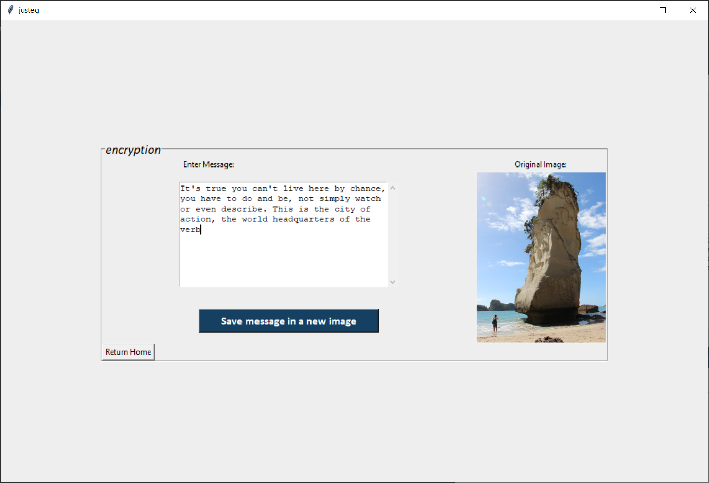
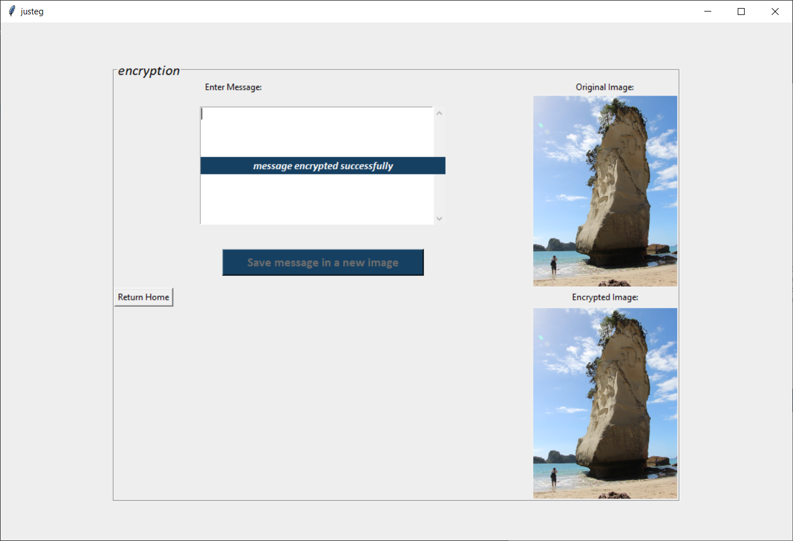
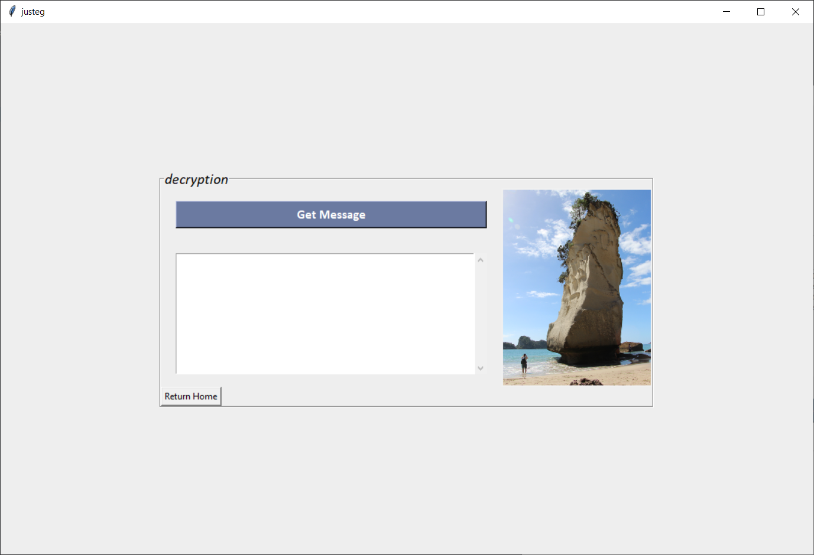
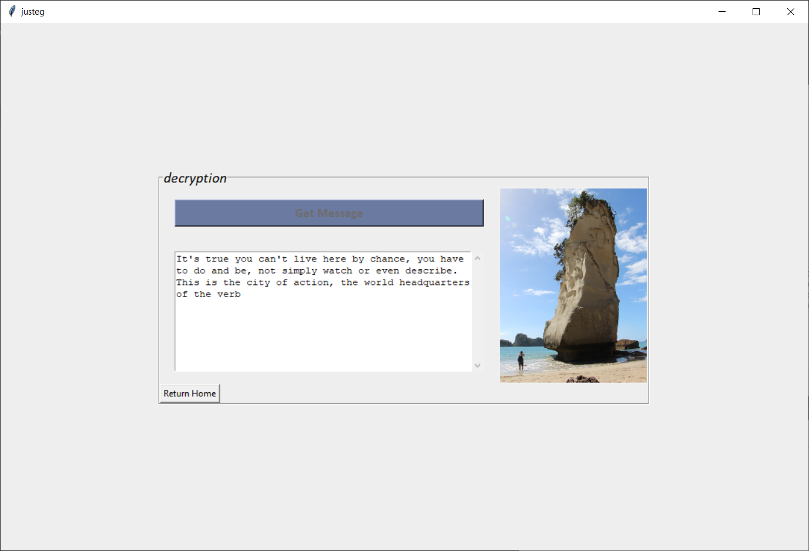

# Justeg

**Hide words in plain sight.** Justeg is a browser steganography lab: it writes a secret message into the lowest bits of an image's pixels, optionally encrypted, and reads it back. Nothing is uploaded; every pixel is processed on your device.


The name comes from the idea behind it: **ju**st a simple **steg**anography tool. It also sounds a bit like an Easter egg, the hidden jokes developers leave in their programs, which is exactly what Justeg is for: hiding funny messages in small images or a website's favicon.

## What it does

- **Hide** any Unicode message in a PNG, JPEG, WebP, GIF, BMP or ICO and download the result as a lossless PNG.
- **Encrypt** with a passphrase: AES-256-GCM, a PBKDF2-SHA256 key (600k iterations), and bits scattered across the image by a keyed permutation. Without the passphrase there is nothing to find.
- **Reveal** messages, with automatic detection of 1- or 2-bit depth and tamper detection.
- **Inspect** any image's lowest bit plane, and after hiding, see a map of every channel that changed.
- **Read favicons** from any website. Try Justeg's own icon: there is an egg in it.

| Hide, then inspect the changes | Read a favicon |
|---|---|
|  |  |

## Engineering

| | |
|---|---|
| [Requirements](docs/requirements.md) | Functional and non-functional requirements with IDs |
| [Architecture](docs/architecture.md) | Modules, data formats, data layer, flows and test strategy |
| [Threat model](docs/threat-model.md) | STRIDE analysis and honest limits |
| [Decisions](docs/adr/) | Why client-side, why a length header, why Feistel, how the proxy is hardened, why MySQL |
| [Deployment](docs/deployment.md) | Hostinger Business: Node.js web app and MySQL database, and running locally |

**Stack:** Next.js 16, React 19, TypeScript (strict), Web Crypto, MySQL (`mysql2`), Vitest, ESLint, GitHub Actions.

## Quick start

```bash
npm ci
npm run dev
```

Then open http://localhost:3000. No database is needed locally. See [deployment](docs/deployment.md) to host it with a database on Hostinger.

## Limits

LSB steganography does not survive lossy recompression. Re-saving as JPEG, resizing or sending through most chat and social apps destroys the message, so share the PNG as a file. Statistical analysis can suggest that an image was edited even when it cannot read the message. Unencrypted mode is hidden, not secret.

## History

Justeg started in 2022 as a Python/Tkinter desktop app that hid 7-bit ASCII in PBM images with an end-of-transmission marker. That version lives in [`legacy/python`](legacy/python). Version 2 keeps the idea and fixes its weaknesses: no encryption, a predictable marker, sequential embedding and ASCII-only text.

<details>
<summary>Screenshots of the 2022 version</summary>

| Before | After |
|:---:|:---:|
|  |  |
|  |  |

</details>
