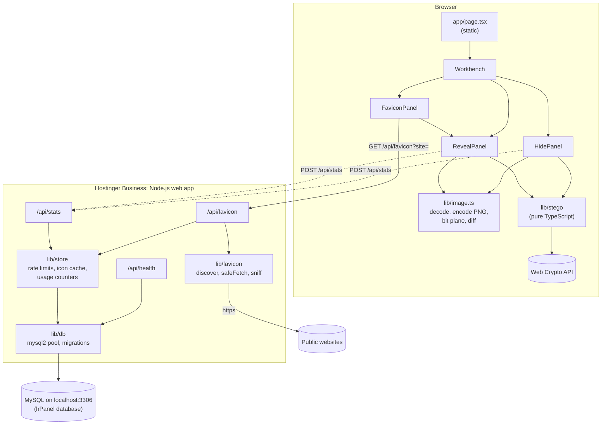
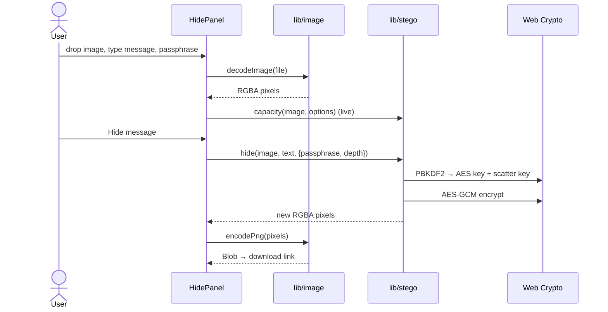
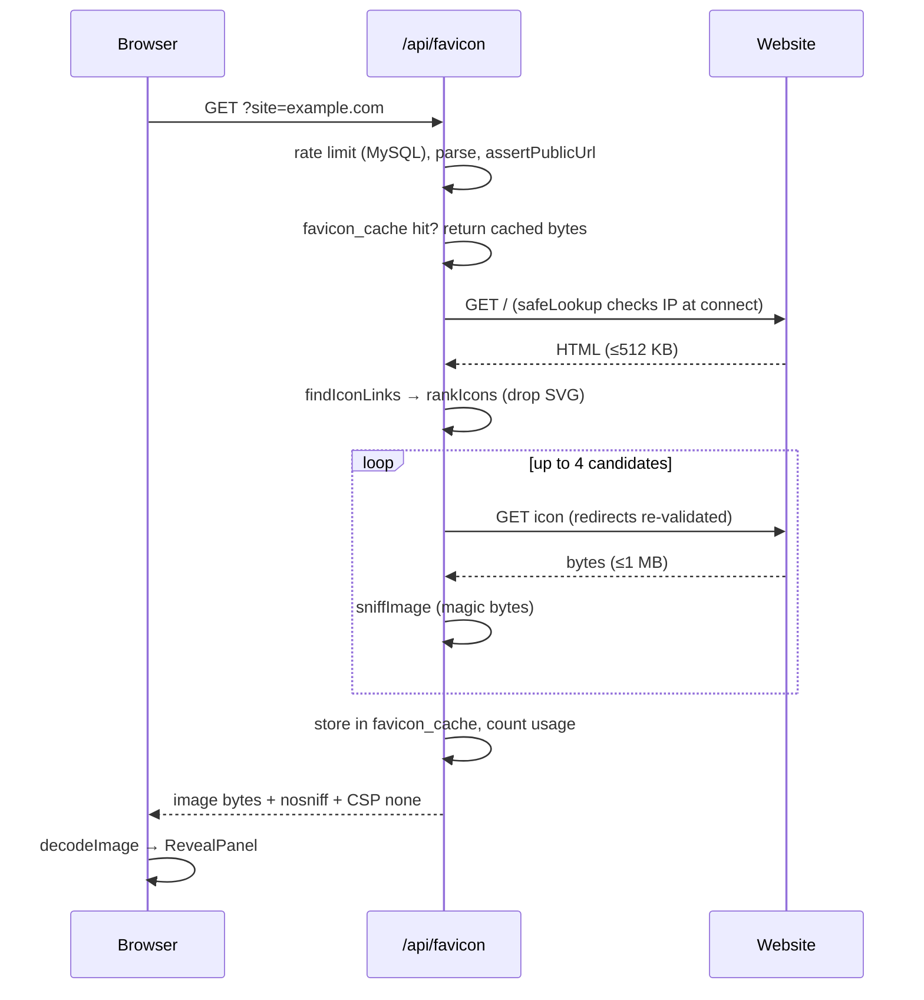
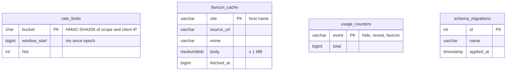

# Justeg architecture

## Overview

Justeg is a Next.js app with one page and three API routes, hosted as a Node.js web app on Hostinger Business web hosting with the plan's MySQL database. Almost all of the work happens in the browser: decoding the image, writing or reading bits, encrypting, and encoding the PNG. The server serves static assets, proxies favicons and keeps a little anonymous state. Images, messages and passphrases never reach it.



## Modules

| Module | Responsibility | Depends on |
|---|---|---|
| `src/lib/stego` | Bit packing, slot orders, plain and sealed containers, the public `hide` / `reveal` / `capacity` API. | Web Crypto only. No DOM, no React. |
| `src/lib/image.ts` | Turns files into RGBA pixels and back into PNG, with colour-space conversion off; forensic views. | Canvas, `createImageBitmap`. |
| `src/lib/favicon` | Server-only: parse the site input, discover icon links, fetch safely, sniff formats. | `node:http(s)`, `node:dns`. |
| `src/lib/store` | Server-only persistence ports (`RateLimitStore`, `FaviconCache`, `UsageStats`) with MySQL and in-memory implementations; `getStores()` picks one from the environment. | `lib/db`. |
| `src/lib/db` | Reads `DATABASE_URL` / `DB_*`, owns the connection pool and the migrations. | `mysql2`. |
| `src/components` | React UI. Each panel owns its state; shared controls are CSS modules. | `lib/*`. |
| `src/app` | Next.js routes, layout, global design tokens, icon. | Everything above. |

The dependency direction is one way: `app → components → lib`. `lib/stego` imports nothing from the rest of the app, which is what makes it testable in Node (NFR-Q1).

## The steganography core

### Slots and orders

An image of *P* pixels has *3P* **slots**, one per RGB channel. Alpha is never written. A `SlotOrder` maps the *i*-th chunk of payload to a slot. Two orders exist:

- `sequentialOrder`: slot *i* is slot *i*. Used for plain messages and for the salt.
- `scatterOrder`: a 4-round Feistel network over the smallest even-bit domain that covers the slots, with cycle-walking to stay in range. It is a bijection, costs O(1) memory and is keyed by 128 bits from PBKDF2 (NFR-P3, NFR-S3).

`writeBits` / `readBits` move bytes through an order at 1 or 2 bits per slot, most significant bit first.

### Containers

Plain (FR-2, FR-9):

```
sequential:  "JSTG" | version=1 | length u32 | UTF-8 text
```

Sealed (FR-5, FR-10, NFR-S2, NFR-S3):

```
sequential:  salt (16 bytes)
scattered:   length u32 | IV (12) | AES-GCM ciphertext + tag (16)
```

PBKDF2-SHA256 (600,000 iterations) turns passphrase + salt into 512 bits: 256 for the AES key and 256 for the scatter key. The bit depth is bound to the ciphertext as additional authenticated data. The reader tries both depths; for each it reads the salt, derives keys, follows the scatter order and attempts decryption. GCM's tag check means the first success is certain, and every failure is reported the same way.

### Why output is opaque

Canvas stores premultiplied alpha. A pixel with alpha below 255 loses low bits of its colour on the way in and out, and a fully transparent pixel loses its colour completely. Forcing alpha to 255 before embedding guarantees the bits written are the bits read.

## Hide flow



## Favicon flow



## Data layer

The database holds only server-side bookkeeping. See [ADR 0005](adr/0005-mysql-on-hostinger.md) for why MySQL, and the [deployment guide](deployment.md) for setting it up on Hostinger.



- **Ports and adapters.** Routes depend on the interfaces in `lib/store/types.ts`. With database settings, `getStores()` returns MySQL adapters; without them, in-memory ones. One contract test suite runs against both (`lib/store/contract.ts`).
- **Connection pool.** One `mysql2` pool of 5 connections per process, cached on `globalThis` so dev reloads reuse it.
- **Migrations** are ordered SQL statements in `lib/db/migrations.ts`. The first query after start-up waits for `migrate()`, which takes `GET_LOCK('justeg_migrate')`, applies anything not in `schema_migrations` and records it. A failed migration is not cached, so the next request retries. `npm run db:schema` writes the same SQL to `db/schema.sql`.
- **Rate limiting** is a fixed one-minute window per bucket: an upsert that resets the count when the window changes, then a read of the count. About 1% of writes also delete windows older than the previous one.
- **Favicon cache** is keyed by host name with a 24-hour freshness check on read. Responses carry `x-favicon-cache: hit|miss`.
- **Usage counters** are incremented by the favicon route itself and by fire-and-forget `POST /api/stats` calls from the browser after a successful hide or reveal. The body is just the event name, and posts are rate limited (30 per minute per client).
- **Failure behaviour.** If the database is unreachable, `/api/health` returns 503, the favicon route fails closed with 503, and the footer counter hides itself. Hiding and revealing are unaffected because they never touch the server.

## Cross-cutting concerns

- **Security headers** are set for every route in `next.config.ts` (NFR-S6).
- **Fonts** are self-hosted with Fontsource, so no request leaves for Google Fonts (NFR-S7).
- **Accessibility**: tabs follow the WAI-ARIA tab pattern with arrow keys; status lines are `aria-live`; the bit-depth picker is a radio group; motion respects `prefers-reduced-motion` (NFR-U2, NFR-U3).
- **Limits** on file size and pixel count live in `lib/image.ts` (NFR-P2).

## Testing strategy

| Layer | Tool | What is covered |
|---|---|---|
| Core | Vitest (Node) | Bit packing, permutation properties, plain and sealed round trips, capacity edges, wrong passphrase, tampering, randomness of output. |
| Favicon server | Vitest (Node) | Blocked address ranges, URL policy, DNS guard, link discovery and ranking, magic-byte sniffing. |
| Data layer | Vitest (Node) + MariaDB | One store contract run against memory and a real MariaDB server (a CI service container; locally when `TEST_DATABASE_URL` is set); config parsing; migration ordering and idempotence; `db/schema.sql` kept in sync. |
| UI | Manual and Playwright smoke run | Hide → download → reveal; wrong passphrase; favicon Easter egg; mobile width. |

CI runs lint, type-check, all unit and database tests and a production build on every pull request (NFR-Q2).

## Decisions

See [`adr/`](adr/) for the reasoning behind the main choices.
