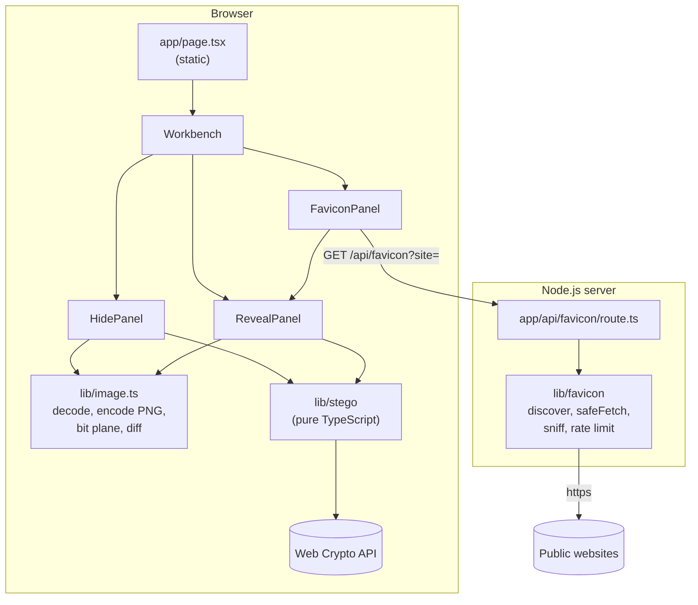
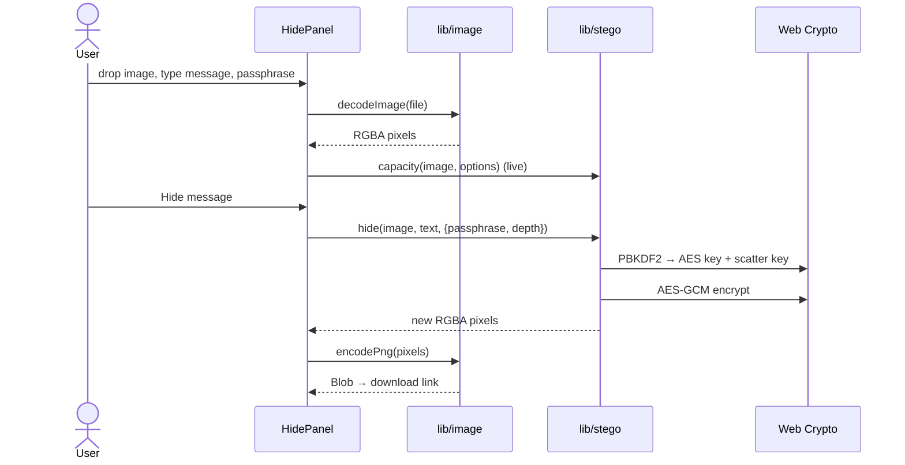
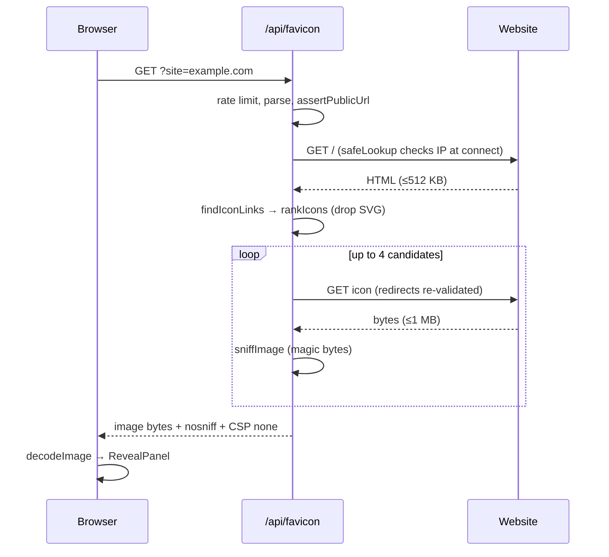

# Justeg architecture

## Overview

Justeg is a Next.js app with one page and one API route. Almost all of the work happens in the browser: decoding the image, writing or reading bits, encrypting, and encoding the PNG. The server only serves static assets and proxies favicons.



## Modules

| Module | Responsibility | Depends on |
|---|---|---|
| `src/lib/stego` | Pixel and UTF-8 primitives, bit packing, slot orders, plain and sealed containers, the 2022 prototype reader, the public `hide` / `reveal` / `capacity` API. | Web Crypto only. No DOM, no React. |
| `src/lib/image.ts` | Turns files into RGBA pixels and back into PNG or PPM, with colour-space conversion off; forensic views. | Canvas, `createImageBitmap`, `lib/netpbm`. |
| `src/lib/netpbm.ts` | Netpbm (P1–P6) reader and binary PPM writer, since browsers cannot decode the format. | Nothing. |
| `src/lib/colour.ts` | sRGB to CIELAB and ΔE, used by the "How it works" diagrams. | Nothing. |
| `src/lib/favicon` | Server-only: parse the site input, discover icon links, fetch safely, sniff formats, rate limit. | `node:http(s)`, `node:dns`. |
| `src/components` | React UI. Each panel owns its state; shared controls are CSS modules and small components such as `StatusMessage`. | `lib/*`, `hooks`. |
| `src/hooks` | Client-side React hooks shared by components, such as rAF-throttled pointer tracking. | React. |
| `src/app` | Next.js routes, layout, global design tokens, icon. | Everything above. |

The dependency direction is one way: `app → components → hooks, lib`. `lib/stego` imports nothing from the rest of the app, which is what makes it testable in Node (NFR-Q1).

## The steganography core

### Slots and orders

An image of *P* pixels has *3P* **slots**, one per RGB channel. Alpha is never written. A `SlotOrder` maps the *i*-th chunk of payload to a slot. Two orders exist:

- `sequentialOrder`: slot *i* is slot *i*. Used for plain messages and for the salt.
- `scatterOrder`: a 4-round Feistel network over the smallest even-bit domain that covers the slots, with cycle-walking to stay in range. It is a bijection, costs O(1) memory and is keyed by 128 bits from PBKDF2 (NFR-P3, NFR-S3).

`writeBits` / `readBits` move bytes through an order at 1 or 2 bits per slot, most significant bit first.

### Containers

Plain (FR-2, FR-9):

```
sequential:  "JSTG" | version=1 | length u32 | UTF-8 text
```

Sealed (FR-5, FR-10, NFR-S2, NFR-S3):

```
sequential:  salt (16 bytes)
scattered:   length u32 | IV (12) | AES-GCM ciphertext + tag (16)
```

PBKDF2-SHA256 (600,000 iterations) turns passphrase + salt into 512 bits: 256 for the AES key and 256 for the scatter key. The bit depth is bound to the ciphertext as additional authenticated data. The reader tries both depths; for each it reads the salt, derives keys, follows the scatter order and attempts decryption. GCM's tag check means the first success is certain, and every failure is reported the same way.

Legacy, read only (FR-16, [ADR 0005](adr/0005-netpbm-and-legacy-reader.md)):

```
sequential, 2 bits per slot:  7-bit ASCII ... | EOT (0000100 or 00000100)
```

Tried only for Netpbm images without a passphrase, after the plain container is not found. It has no signature, so it accepts only non-empty printable text that ends in the terminator.

### Why output is opaque

Canvas stores premultiplied alpha. A pixel with alpha below 255 loses low bits of its colour on the way in and out, and a fully transparent pixel loses its colour completely. Forcing alpha to 255 before embedding guarantees the bits written are the bits read.

## Hide flow



## Favicon flow



## Cross-cutting concerns

- **Security headers** are set for every route in `next.config.ts` (NFR-S6).
- **Fonts** are self-hosted with Fontsource, so no request leaves for Google Fonts (NFR-S7).
- **Accessibility**: tabs follow the WAI-ARIA tab pattern with arrow keys; status lines are `aria-live`; the bit-depth picker is a radio group; motion respects `prefers-reduced-motion` (NFR-U2, NFR-U3).
- **Limits** on file size and pixel count live in `lib/image.ts` (NFR-P2).

## Testing strategy

| Layer | Tool | What is covered |
|---|---|---|
| Core | Vitest (Node) | Bit packing, permutation properties, plain and sealed round trips, capacity edges, wrong passphrase, tampering, randomness of output, Netpbm variants, the prototype's sample images, colour difference maths. |
| Favicon server | Vitest (Node) | Blocked address ranges, URL policy, DNS guard, link discovery and ranking, magic-byte sniffing. |
| UI | Manual and Playwright smoke run | Hide → download → reveal; wrong passphrase; favicon Easter egg; mobile width. |

CI runs a Prettier format check, lint, type-check, all unit tests and a production build on every pull request (NFR-Q2).

## Release and provenance

Publishing a GitHub release runs `.github/workflows/release.yml` (NFR-S9):

1. Test and build on a GitHub-hosted runner.
2. Pack the production bundle (`.next` without its cache, `package.json`, `package-lock.json`, `next.config.ts`) reproducibly: sorted entries, fixed owners and the commit timestamp, so the digest depends on content alone.
3. Sign a SLSA build provenance attestation for that digest with `actions/attest-build-provenance`. Signing uses the workflow's short-lived OIDC identity through Sigstore, so there is no long-lived key to manage.
4. Attach the bundle and its SHA-256 checksum to the release.

Each job gets only the permissions it needs. The build job can read the repository and write attestations; only the publish job can write release assets. Every action is pinned to a full commit SHA.

## Decisions

See [`adr/`](adr/) for the reasoning behind the main choices.
