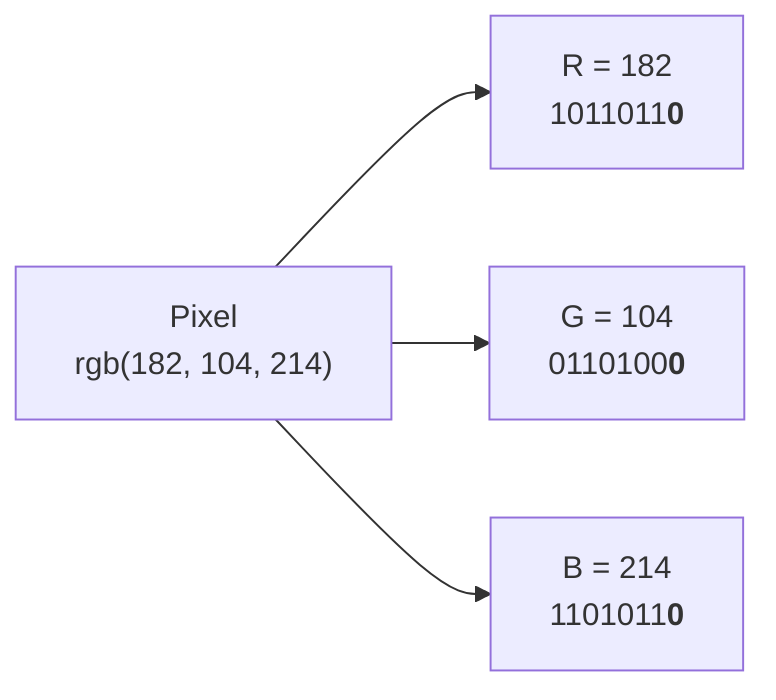
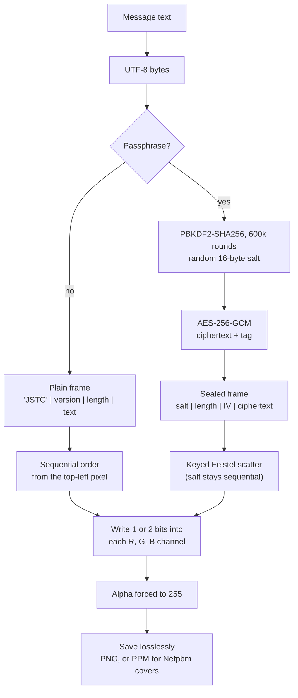
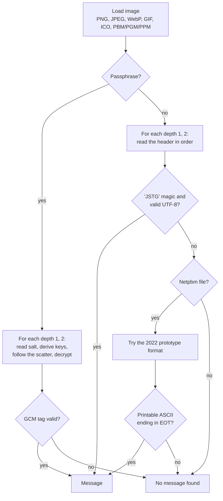

# How Justeg works

This page explains, from the pixel up, how Justeg hides text in an image and why the change cannot be seen. The app's own "How it works" section has interactive versions of these diagrams. For module structure and data formats in engineering terms, see [architecture.md](architecture.md).

## 1. An image is a grid of numbers

Every pixel stores three colour channels, red, green and blue, each as one byte: an integer from 0 to 255 written as 8 bits.



The bits are not equal. Reading left to right, they are worth 128, 64, 32, 16, 8, 4, 2 and 1 steps of intensity. The rightmost bit, the **least significant bit (LSB)**, is worth a single step out of 256.

```
bit position   7    6    5    4    3    2    1    0
worth        128   64   32   16    8    4    2    1
R = 182        1    0    1    1    0    1    1    0
                                                  ^ the least significant bit
```

## 2. Why changing the LSB is not noticeable

Changing the LSB moves a channel by exactly ±1, a change of 0.4% of its range. Whether a person can see a change is measured in the CIELAB colour space, which is built so that equal distances look roughly equally different. The distance is called ΔE, and a ΔE of about **2.3** is the commonly cited *just-noticeable difference*: below it, two colours side by side look identical to most people.

Flipping one bit in all three channels of `rgb(182, 104, 214)` gives:

| Bit flipped | Worth | ΔE | Visible? |
|---:|---:|---:|---|
| 0 (LSB) | 1 | 0.37 | No, about a sixth of the threshold |
| 1 | 2 | 2.35 | At the threshold |
| 2 | 4 | 4.73 | Yes, side by side |
| 3 | 8 | 9.01 | Yes |
| 4 | 16 | 19.69 | Clearly |
| 5 | 32 | 34.99 | Clearly |
| 6 | 64 | 46.97 | Clearly |
| 7 (MSB) | 128 | 159.69 | A different colour |

This table is the worst case: every channel changes. In practice only about half the bits need to change (a message bit matches the existing LSB half the time), and real photos are full of sensor noise and texture that mask small differences even further. Three effects work together:

- **Small step:** ±1 out of 255 is below what the eye can resolve in a flat colour.
- **No pattern:** each channel changes independently, so there are no edges or shapes for the eye to latch on to.
- **Noise masking:** natural images already vary by a few steps between neighbouring pixels, so the change disappears into that variation.

Justeg's **Stealth** mode uses only bit 0. **Capacity** mode uses bits 0 and 1, which doubles the space; the change of up to ±3 sits right at the threshold in flat colour, and is still hidden by texture in a typical photo.

Invisible is not the same as undetectable. Statistical tests can notice that the LSBs of an image are more random than they should be, even when they cannot read the message. See the [threat model](threat-model.md).

## 3. A worked example: hiding "J"

"J" is byte 74, or `01001010`. Each of its 8 bits replaces the LSB of one channel, so it needs 8 channels, just under three pixels.

| Pixel | Channel | Before | Message bit | After | Change |
|---:|:---:|---|:---:|---|:---:|
| 1 | R | `0111011`**`0`** | 0 | `0111011`**`0`** | 0 |
| 1 | G | `1010010`**`0`** | 1 | `1010010`**`1`** | +1 |
| 1 | B | `1101010`**`0`** | 0 | `1101010`**`0`** | 0 |
| 2 | R | `0111100`**`1`** | 0 | `0111100`**`0`** | −1 |
| 2 | G | `1010011`**`0`** | 1 | `1010011`**`1`** | +1 |
| 2 | B | `1101010`**`1`** | 0 | `1101010`**`0`** | −1 |
| 3 | R | `0111011`**`1`** | 1 | `0111011`**`1`** | 0 |
| 3 | G | `1010001`**`1`** | 0 | `1010001`**`0`** | −1 |

Five of the eight channels change, each by one step. The largest colour difference among the three pixels is ΔE 1.38.

## 4. From message to image



The length header tells the reader exactly how many bytes to read, so there is no end marker that could appear inside the message by accident.

With a passphrase, the order in which channels are used comes from a keyed permutation. Without the key, a reader does not know which channels hold the message or in what order, and the frame has no fixed signature to search for. Encryption is what keeps it secret; the scatter is what removes the visible band.

## 5. From image back to message



A wrong passphrase derives a different key, which reads different channels and fails the authentication tag. It is reported the same way as an image with no message, never as garbled text.

## 6. Where the bits live in each container

```
Plain     ┌──────┬─────┬────────┬──────────────────────────┐
(in order)│ JSTG │ ver │ length │ UTF-8 text               │
          │  4 B │ 1 B │   4 B  │ n B                      │
          └──────┴─────┴────────┴──────────────────────────┘

Sealed    ┌──────┬────────┬──────┬──────────────────┬──────┐
          │ salt │ length │  IV  │ ciphertext       │ tag  │
          │ 16 B │   4 B  │ 12 B │ n B              │ 16 B │
          └──────┴────────┴──────┴──────────────────┴──────┘
           in order └──────── scattered by the key ────────┘
```

In the plain container every field is written in order from the first pixel. In the sealed container only the salt is written in order; everything after it is scattered across the whole image by the key derived from the passphrase and salt.

## 7. Seeing it for yourself

Load any image in the app and switch the preview to **Bit plane**. It paints every LSB as full black or full colour. A natural photo looks like static. After hiding a plain message, a band of different-looking noise appears along the top rows, where the message was written in order. After hiding an encrypted message, the change is spread evenly across the whole image and the band is gone. The **Changes** view marks every channel that the encoder modified.

## 8. Compatibility with the 2022 prototype

The original Python tool worked on binary Netpbm files (`P6` rasters with a `.pbm` extension). It stored 7-bit ASCII in the two lowest bits of every byte, starting at the first pixel, and ended the message with the EOT control character. Justeg reads and writes Netpbm, and when a Netpbm image holds no current-format message it falls back to that legacy format, so the prototype's sample images in [`legacy/python/sample_images`](../legacy/python/sample_images) still reveal their messages. New messages are always written in the current format. See [ADR 0005](adr/0005-netpbm-and-legacy-reader.md).
