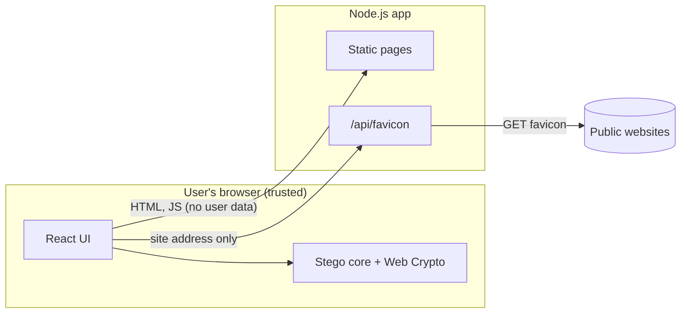

# Justeg threat model

This is a lightweight STRIDE analysis of Justeg v2. It explains what Justeg protects, from whom, and where its protection ends.

## What we protect

| Asset | Why it matters |
|---|---|
| The hidden message | The whole point of the app. |
| The fact that a message exists | Steganography's promise is that nobody suspects a message. |
| The user's images | Personal photos should not leave the device. |
| The server and its network | The favicon proxy makes outbound requests on behalf of visitors. |

## Trust boundaries

Images, messages and passphrases stay inside the browser. The only user input that reaches the server is a website address for the favicon reader.

## Adversaries

1. **Passive observer** sees the stego image (for example, in an email) and wants to read or detect the message.
2. **Active tamperer** modifies the image in transit.
3. **Malicious visitor** abuses the favicon proxy to reach internal services or to exhaust resources.
4. **Malicious website** returns hostile responses to the favicon proxy.

## STRIDE

| Threat | Example | Mitigation | Residual risk |
|---|---|---|---|
| **Information disclosure** of the message | Observer runs an LSB extractor on the image. | AES-256-GCM encryption with a PBKDF2-derived key; bits scattered by a keyed permutation; no magic number in encrypted mode. | Weak passphrases can be brute-forced offline. 600k PBKDF2 iterations slow this, and the UI encourages long passphrases. |
| **Information disclosure** of the message's existence | Steganalysis (chi-square, RS analysis, bit-plane inspection). | Scattering removes the obvious "band at the top"; 1-bit mode changes about half the touched channels by ±1. | Statistical tests can still flag that LSBs were edited. Justeg is not undetectable and says so. |
| **Information disclosure** of images | A server log or analytics script sees a photo. | All processing is client-side; no third-party scripts or fonts; CSP `connect-src 'self'`. | A compromised hosting account could ship malicious JavaScript. Out of scope for the app; mitigated by hosting account security. |
| **Tampering** with the message | Attacker flips bits so the reveal shows altered text. | GCM authentication tag; any change fails closed with "no message found". | Unencrypted mode has no integrity protection, by design. |
| **Spoofing** the sender | Attacker hides their own message in an image. | Only someone with the passphrase can create a message that decrypts with it. | Anyone can create unencrypted messages. There are no signatures. |
| **Server-side request forgery** | `?site=169.254.169.254`, `localhost`, decimal IPs, IPv6-mapped IPv4, DNS names resolving to private ranges, redirects into private ranges, DNS rebinding. | Scheme and port allow-list; credentials refused; literal IPs checked; DNS checked inside the socket's `lookup` so the validated address is the connected one; every redirect re-validated; at most 3 redirects. | New private ranges or IPv6 transition mechanisms not on the block list. The list is unit tested and easy to extend. |
| **Denial of service** via the proxy | Many lookups, huge responses, slow-loris servers. | Per-IP rate limit (20 per minute); 512 KB page and 1 MB icon caps enforced while streaming; 5 s timeouts; at most 4 icon candidates. | The rate limiter is in-memory for a single instance. A distributed attacker could still consume the plan's CPU allowance. |
| **Malicious content** from a website | Proxy returns HTML or SVG with script as an "icon". | Magic-byte sniffing allows only PNG, ICO, GIF, JPEG, WebP and BMP; SVG is never fetched or returned; responses carry `nosniff` and `Content-Security-Policy: default-src 'none'`. | Browser image decoder bugs. Mitigated by keeping browsers updated. |
| **Elevation of privilege** in the page | XSS through a revealed message. | Messages are rendered as React text, never HTML; strict CSP with `object-src 'none'` and `base-uri 'none'`. | `script-src 'unsafe-inline'` is required by Next.js's inline bootstrap. A nonce-based CSP would remove it at the cost of dynamic rendering. |
| **Repudiation** | Not applicable: the app has no accounts or server-side actions on user data. | | |

## Known limitations

- **Lossy channels destroy the payload.** JPEG recompression, resizing and most messaging apps rewrite pixels. Users must send the PNG as a file.
- **Transparent pixels.** Browsers lose the colour of fully transparent pixels, so Justeg flattens output to opaque. Icons with transparency are read as-is and rarely carry messages written by other tools.
- **Passphrase sharing** is the user's job. Justeg never transmits it.
